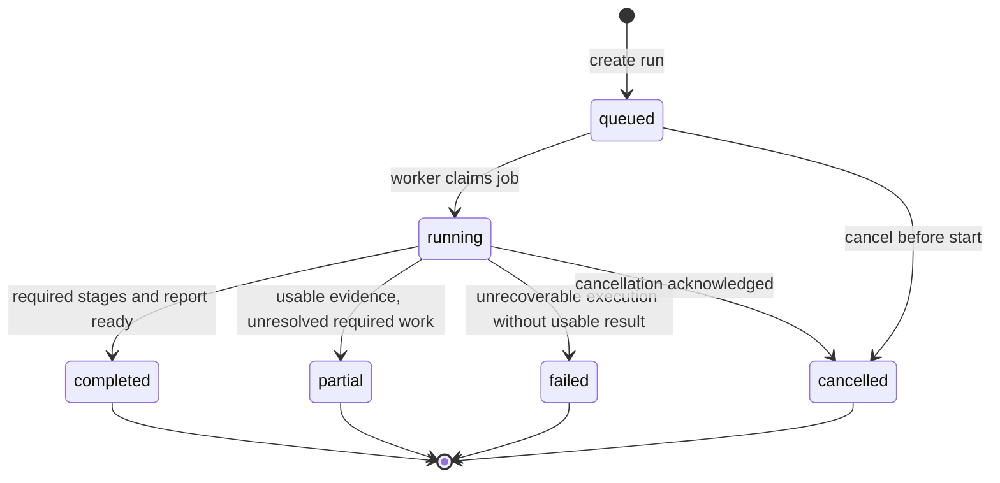

# CASETRACE — Investigation State Machine

Refactor 05 internal tasks use planned → ready → running → completed/failed/cancelled,
with skipped for unavailable dependencies, cycles or budgets. These are task states,
not new public run states. Leads use proposed/approved/rejected/completed/unresolved.
Adaptive stage outcomes reflect failed/skipped work; baseline behavior is retained.
Task assignment/attempt/outcome events and context checkpoints are durable. Restart
reconciles unfinished tasks/leads from committed events, including events newer than
the last checkpoint. Retry remains a new investigation; no resume/cancel API is added.

Implemented Phase 3 mapping: `partial` -> `completed_with_limitations`,
candidate/under_review -> proposed, refuted -> rejected, inconclusive -> unresolved.
See [Phase 3 decisions](phase-3-decisions.md). Run retry creates a new POST.
Startup fails interrupted queued/running runs; successful results are never
invented on recovery. One process-local worker executes each run with a guarded
claim. No cancellation/resume HTTP endpoint is implemented.

Persistence uses SQLite through the controlled application service described in [development stack](development-stack.md). Commit state changes and durable events atomically, require version/status guards, and enforce unique retry/result keys. Emit SSE after commit; do not share sessions between agents or hold transactions across external work.

**Document:** `docs/investigation-state-machine.md`
**Status:** Proposed canonical lifecycle; reconcile with existing API contracts before implementation  
**Version:** 1.0 · **Scope:** CASE-001 MVP and extensible multi-agent runs

## 1. Purpose and boundaries

Define persisted run, stage, agent, tool, finding and report lifecycles so frontend, FastAPI workers, event streaming and recovery use a single coherent model. The **backend is authoritative**; a lost SSE connection does not change run state. Agents must not access hidden case answer keys. Investigation output supports review of synthetic records, not clinical diagnosis.

## 2. Lifecycle vocabulary and ownership

| Aggregate | Owner | Proposed states |
|---|---|---|
| Investigation | InvestigationService | `queued`, `running`, `completed`, `partial`, `failed`, `cancelled` |
| Stage | Orchestrator | `pending`, `running`, `completed`, `skipped`, `failed` |
| Agent execution | Orchestrator | `queued`, `running`, `completed`, `failed`, `cancelled` |
| Tool call | Tool registry | `requested`, `running`, `succeeded`, `failed`, `timed_out` |
| Finding | Evidence service | `candidate`, `under_review`, `verified`, `refuted`, `inconclusive` |
| Report | Report service | `pending`, `generating`, `ready`, `failed`, `superseded` |

**Important:** These are the recommended normalized names. If `frontend-backend-contract.md` or existing schemas specify a different enum, create an explicit mapping/ADR and update contract tests; do not silently ship competing sets. `completed` means the workflow finished, **not** that a contradiction was found. `partial` means useful information exists but mandatory execution/evidence requirements were not met.

## 3. Investigation transitions



- Terminal states are immutable for one run; **retry creates a new run** with `retry_of_investigation_id` (preferred) or follows a separately approved resume contract.
- Transitions must be atomic and guarded by current-state checks. Never allow two workers to claim one active run.
- Cancel requests are idempotent and best-effort while running; terminal run cannot be reopened by delayed tool events.
- A run must be scoped to exactly one selected patient; cross-patient retrieval is forbidden by default.

## 4. Invariants

1. Investigation IDs, patient IDs, case versions, dataset fingerprint, request IDs and actor/tenant scope are persisted before execution.
2. Every state transition records `from_state`, `to_state`, UTC `occurred_at`, transition reason, actor/worker and monotonically ordered event ID or sequence.
3. No `completed` run without persisted final report (`ready`) and successful validation of required citation anchors. A report may explicitly conclude **no supported contradiction**.
4. `verified` finding requires resolvable source-version anchors and a successful evidence-verification record; raw model prose cannot set this status.
5. Tool execution is audited even on timeout, provider failure, and cancellation. No fabricated success events.
6. The original hospital source data is read-only during investigations. Derived timeline, claims and reports are stored separately.
7. Partial failures are disclosed in final output, not treated as normal-negative evidence.
8. Ground-truth/evaluator tables and files must be inaccessible to tool credentials and application runtime.

## 5. Stage dependency graph

| Stage key | Depends on | Minimum output | Failure handling |
|---|---|---|---|
| `record_discovery` | Patient resolved | Source manifest and IDs | Fail run if no patient/access |
| `timeline_reconstruction` | Retrieval complete enough | Structured temporal events with references | Partial if crucial timestamps unavailable |
| `specialist_analysis` | Relevant record retrieval | Lab and medication observations with provenance | Skip irrelevant specialist with reason; partial on required tool failure |
| `contradiction_verification` | Candidate findings available | Explicit supported/refuted/inconclusive classification with sources | Inconclusive or partial; never fabricate verification |
| `report_synthesis` | Verification state determined | Final versioned report, claim links, limits | Failed/partial if generation cannot complete |

Actual agent implementations may execute independent retrieval/analysis concurrently. Persist dependency edges, not a fictional fixed order of tool calls.

## 6. Stage, agent and tool handling

**Stage:** `pending → running → completed | skipped | failed`. Retry must be a separate attempt row with `attempt_number`, not overwrite historical events.  
**Agent:** `queued → running → completed | failed | cancelled`. Per-agent task summaries can be shown; private chain-of-thought must not be stored/exposed.  
**Tool:** `requested → running → succeeded | failed | timed_out`. Persist `tool_name`, sanitized parameters, record IDs, time, duration, error category, result digest, source refs and attempt number. The payload is untrusted clinical data, not executable instructions.

## 7. Finding verification state machine

```text
candidate → under_review → verified | refuted | inconclusive
```

- Candidate: an apparent conflict or hypothesis, not a confirmed clinical conclusion.
- Under review: source A/B and their timestamp semantics retrieved; alternative explanations investigated.
- Verified: the **record-level discrepancy** is confirmed with sufficient retrievable evidence, while medical implications may remain uncertain.
- Refuted: difference explained or contradiction unsupported.
- Inconclusive: missing or conflicting sources prevent a supported determination.
- No finding is automatically verified because a model assigns a high confidence value.
- If new evidence emerges after finalization, generate a new finding version/reassessment rather than rewriting history.

## 8. Event envelope and SSE

The transport shape **must follow the existing frontend/backend contract**. If still unresolved, adopt this proposal:

```json
{
  "event_id": "evt-000045",
  "investigation_id": "INV-001",
  "sequence": 45,
  "type": "tool.completed",
  "occurred_at": "2026-10-20T08:05:12Z",
  "attempt": 1,
  "payload": {"tool_call_id":"TC-013", "tool_name":"get_document", "status":"succeeded", "source_refs":["DOC-009"]}
}
```

Event types: `investigation.queued`, `investigation.started`, `stage.started`, `stage.completed`, `agent.started`, `agent.completed`, `tool.started`, `tool.completed`, `tool.failed`, `finding.candidate`, `finding.verified`, `finding.refuted`, `report.ready`, `investigation.partial`, `investigation.completed`, `investigation.failed`, `investigation.cancelled`. Do not expose report/ground-truth-only content in stream payloads. Use the canonical event-type registry in code.

**Reconnect:** frontend first reads authoritative state; then connects using a monotonic cursor/Last-Event-ID when supported. Server replays persisted events after cursor. Client deduplicates by event ID, sorts by sequence, and re-fetches snapshot on gaps. Disconnect never implies run failure.

## 9. Concurrency, retries and idempotency

- `POST` create-investigation requests accept an idempotency key if defined by the API; repeated submissions must not create duplicate runs inadvertently.
- Claim work via an atomic version/status-guarded update or guarded lease with heartbeat; validate affected-row count and define lease expiry and bounded retry policy. SQLite has no row-level `FOR UPDATE` locks. Use transactional outbox if publishing and persistence are distinct failure domains.
- Retry only known transient, idempotent reads with bounded exponential backoff; model calls and writes require explicit idempotency/attempt semantics.
- Enforce max attempts and deadline at run, stage and tool levels. A worker crash yields recoverable stale lease detection, not a permanently running spinner.
- Cancellation stops scheduling additional tools, records in-flight outcome, and preserves already retrieved audit evidence.

## 10. Recovery and terminal policy

| Condition | Run state | Report behavior |
|---|---|---|
| No source records found | `failed` or contract-defined not-found | No fabricated report |
| Optional imaging preview unavailable | Continue if not required | Include missing asset limitation |
| Required lab retrieval timed out, some evidence present | `partial` | Mark missing evidence and unresolved findings |
| Candidate explanation refuted, all required stages complete | `completed` | Report no verified contradiction |
| Stream disconnect only | No state change | Client reconnects/reconciles |
| Report persistence failed | `partial`/`failed` based on usable output | Not `completed` |
| User cancellation | `cancelled` | Preserve audit, no final-looking diagnosis |

## 11. Database implementation mapping

Suggested tables: `investigations`, `investigation_stages`, `agent_executions`, `tool_calls`, `investigation_events`, `findings`, `finding_evidence_links`, `evidence_refs`, `reports`. See `database-schema.md`. All persisted statuses use explicit enums/check constraints, foreign keys, timestamps and version/attempt fields. Add uniqueness `(investigation_id, sequence)` and `(investigation_id, event_id)` or equivalent.

## 12. API considerations

Keep exact paths from `frontend-backend-contract.md`: create run, get run, stream/list events, fetch findings, fetch report, optional cancel/retry. No browser access to tool internals or evaluation answer keys. All response/status transitions must be included in OpenAPI and typed client definitions.

## 13. Test matrix

- Valid transition from queued to completed via stages and verified citations.
- Invalid direct `queued → completed` and delayed events after terminal state rejected.
- Tool failure and bounded retry reflected correctly in audit.
- Cancellation while queued and while tool running.
- Duplicate create request and double worker claim.
- SSE replay, reconnect, duplicate and out-of-order events.
- Investigation whose only candidate is refuted still completes with honest report.
- Missing source or report version prevents false `verified`/`completed` state.
- Run never fetches answer key; patient scoping enforced for every tool call.

## 14. Definition of done

One seeded CASE-001 run progresses through legal states, writes a complete event trace, survives stream reconnect and worker failure tests, ends in a truthful terminal status, and allows all material report citations to resolve to immutable source records. No status transition is inferred solely in the frontend.
